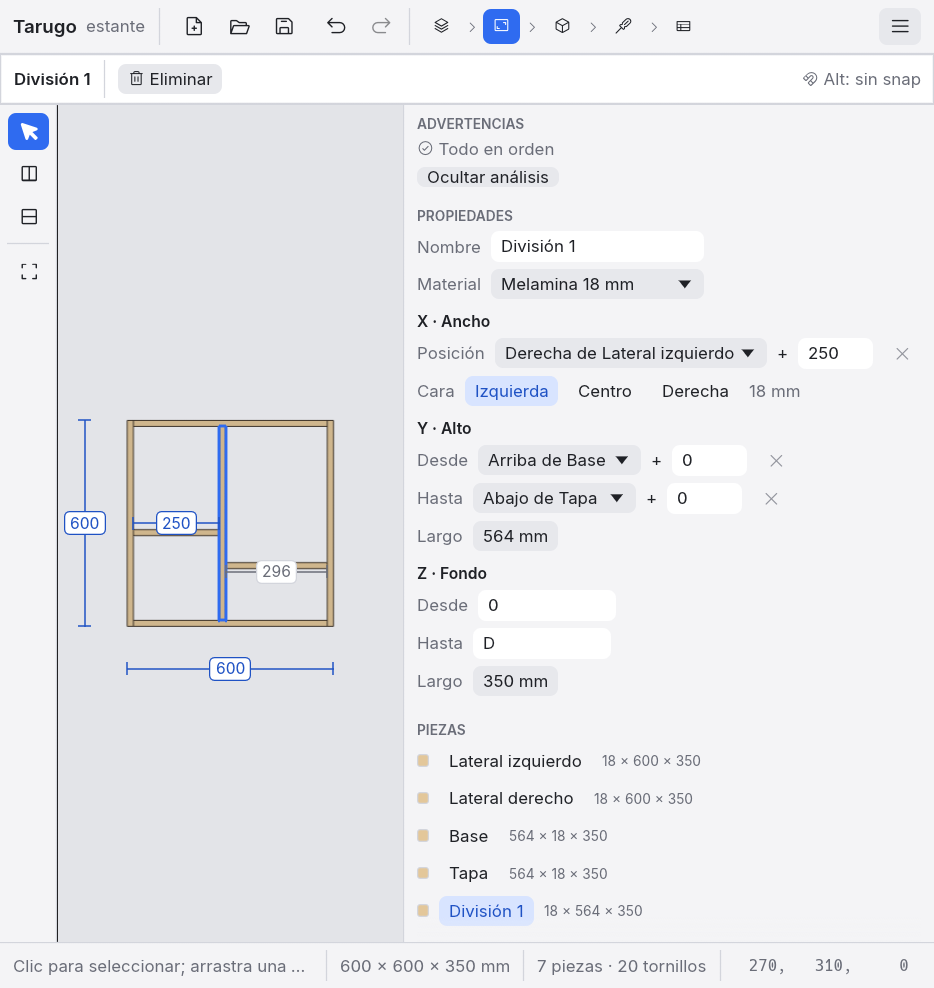

# Tarugo

*[English](README.md)*

Diseña muebles de tableros y palos: dibuja el frente con cotas, dale profundidad, edita
libremente en 3D, marca los tornillos y obtén la lista de corte. App de escritorio para Linux,
macOS y Windows, hecha en Rust con [egui](https://github.com/emilk/egui). La interfaz está en
español e inglés.

"Tarugo" es un nombre provisorio.



## Cómo se hace un diseño

1. **Materiales** — tableros (espesor obligatorio) y palos (sección obligatoria). El largo y
   el ancho de venta son opcionales: solo sirven para estimar cuánto comprar, porque muchos
   servicios de corte ya lo calculan.
2. **Frente** — parte de un marco cuadrado del tablero principal. El ancho y el alto se
   definen escribiendo en las cotas o arrastrando los laterales, y se eligen sus esquinas:
   laterales por fuera (base y tapa entre ellos) o base y tapa por fuera (los laterales entre
   ellas, del mismo largo que las divisiones verticales). Las herramientas de división
   agregan tableros verticales u horizontales ubicados por una cota que puede partir del borde
   interior, del exterior o del centro del vecino, y llegar al borde cercano, al centro o al
   borde lejano del tablero nuevo. También se puede repartir un espacio en partes iguales.
3. **Profundidad** — se pide una vez, al salir del esquema frontal.
4. **Diseño 3D** — órbita, paneo y zoom. Arrastra la pieza seleccionada para moverla, o los puntos de sus
   caras para alargarla o acortarla. Las caras hacen snap a las caras y centros de otras
   piezas y quedan unidas a ellas (mantén **Alt** para desactivarlo). Agrega tableros y palos
   haciendo clic en la cara donde se apoyan, duplica una pieza justo al lado (varios tableros
   para una cubierta) y dale **forma libre**: la vista muestra su cara en plano y dibujas
   los cortes sobre ella — rectángulos, perforaciones, arcos (un semicírculo o lo que
   abarque), ranuras, bocados y polígonos (también cóncavos, con un radio en cada vértice). Un corte dentro del tablero es un calado; si
   cruza el borde, lo muerde. Arrastra un corte para moverlo y sus puntos para cambiarlo,
   redondea o achaflana las esquinas arrastrándolas, o ajusta cada medida en el panel:
   arrastra el valor hacia los lados o haz clic para escribirlo (admite fórmulas). Mantén
   **Ctrl** o **Shift** para que los lados de un polígono queden en múltiplos de 15° y
   alineados con sus otros puntos; al dibujar, teclea un número y Enter para fijar el largo
   del lado, o haz clic en el largo de un lado para cambiarlo. Pon **líneas de guía** a las
   que los cortes se enganchan. Las piezas que se cruzan se pintan de rojo y se listan.
5. **Tornillos** — clic en la cara por donde entra el tornillo, sobre una unión. *Atornillar
   todo* llena las uniones a las que llega un taladro. **Analizar** revisa que cada pieza
   quede sujeta con al menos dos tornillos (si no, podría rotar) y avisa dónde no se puede
   maniobrar el taladro: un cruce de tableros, donde uno tapa la entrada del otro (usar
   tarugos o una ranura), o espacios más angostos que el taladro.
6. **Lista de corte** — cada pieza como el rectángulo que admite un servicio de corte,
   agrupada por material y medida; se copia o se exporta como CSV. Con las medidas de venta
   estima tableros y palos.

Cualquier medida puede ser una fórmula con **parámetros**: `W / 2`, `(H - 2*18) / 3`,
`max(a; 300)`. El marco crea `W`, `H` y `D`; agrega los tuyos en el panel de la derecha. Los
decimales se pueden escribir con coma (`12,5`).

| Ratón | |
|---|---|
| Arrastrar con el botón izquierdo en vacío o sobre una pieza sin seleccionar | Orbitar (panear en el frente) |
| Arrastrar con el derecho | Orbitar · con Shift, panear |
| Arrastrar con el del medio | Panear |
| Rueda | Zoom |
| Clic en una cota | Escribir su valor o una fórmula |

Teclas: `Ctrl+Z` / `Ctrl+Y` deshacer y rehacer, `Ctrl+S` guardar, `Ctrl+O` abrir, `Ctrl+N`
nuevo, `Supr` eliminar, `F` ver todo, `Esc` volver a la herramienta de selección.

## Compilar

```bash
cargo run --release -p tarugo                 # o: cargo run -p tarugo -- samples/estante.tarugo
cargo test --workspace
```

En Linux necesita los paquetes de desarrollo habituales para una ventana:
`libxkbcommon-dev libwayland-dev libxcb-render0-dev libxcb-shape0-dev libxcb-xfixes0-dev`.

## Roadmap

- Sentido de la veta de cada pieza.
- Bordes que llevan tapacantos.
- Optimización de cortes.
- Cajones y puertas.
- Palos redondos.
- Contornos libres editados nodo a nodo.
- Otros tipos de unión: tarugos, ranuras, minifix.
- Instaladores (AppImage, instalador de Windows).

## Licencia

GPL-3.0-or-later. Fuentes: Inter (OFL) y Phosphor Icons (MIT).
