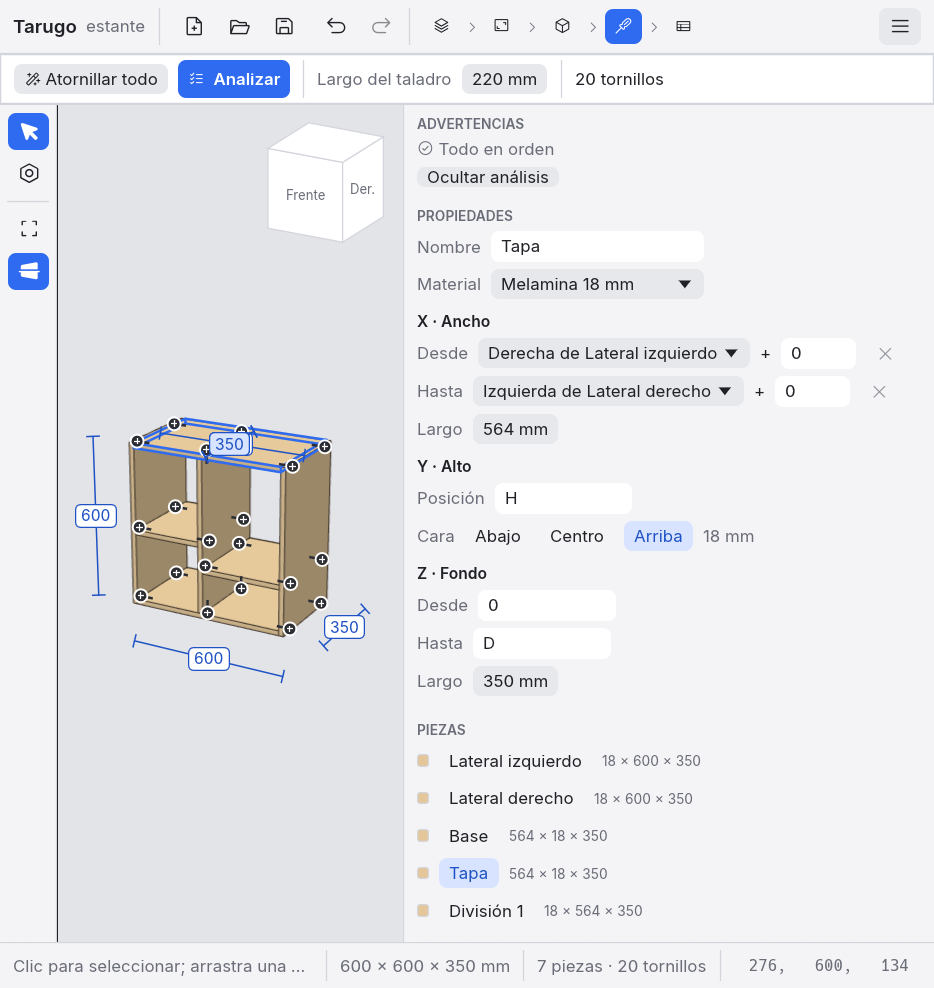

# Tarugo

*[Español](README.es.md)*

Design furniture out of boards and lumber: sketch the front with dimensions, give it a depth,
edit freely in 3D, mark the screws, and get the cut list. Desktop app for Linux, macOS and
Windows, written in Rust with [egui](https://github.com/emilk/egui). The interface is in
Spanish and English.

"Tarugo" (Chilean Spanish for a wooden dowel) is a provisional name.



## How a design goes

1. **Materials** — boards (thickness required) and sticks (section required). Stock length
   and width are optional: they only serve to estimate how much to buy, since many cutting
   services already compute that.
2. **Front** — starts from a square frame of the main board. Set width and height by typing
   on the dimensions or dragging the sides, and choose its corners: sides outside (bottom and
   top between them) or bottom and top outside (the sides between them, as long as every
   vertical division). The divide tools add vertical or horizontal boards
   placed by a dimension that can start at the inner edge, the outer edge or the center of the
   neighbour, and reach the near edge, the center or the far edge of the new board. Or divide
   a space in equal parts.
3. **Depth** — asked once, when leaving the front sketch.
4. **3D design** — orbit, pan and zoom. Drag the selected part to move it, or the dots on its faces to
   stretch it. Faces snap to the faces and middles of other parts and stay attached to them
   (hold **Alt** to turn snapping off). Add boards and sticks by clicking the face they sit
   on, duplicate a part right beside itself (several boards for a top), and give a part a
   **free form**: the view shows its face flat and you draw the cuts on it — rectangles,
   holes, arcs (a half circle, or any span), slots, notches and polygons (concave too, with
   a radius at every vertex). A cut
   inside the board is a cutout; across its border it bites the outline. Drag a cut to move
   it and its points to change it, round or chamfer the corners by dragging them, or set
   every measure in the panel: drag a value sideways or click it to type (formulas work).
   Hold **Ctrl** or **Shift** to keep the sides of a polygon at multiples of 15° and lined
   up with its other points; type a number and Enter while drawing to set the length of the
   side, or click the length of a side to change it. Place **guide lines** for the cuts to
   snap to. Parts that run into each other are painted red and listed.
5. **Screws** — click the face a screw goes in through, over a joint. *Screw everything* fills
   the joints a drill can reach. **Analyze** checks that every part is held by at least two
   screws (or it could rotate) and warns where a drill cannot work: a cross of boards, where
   one covers the entry of the other (use dowels or a dado), or spaces narrower than the
   drill.
6. **Cut list** — every part as the rectangle a cutting service takes, grouped by material
   and size; copy it or export it as CSV. With the stock sizes it estimates sheets and sticks.

Any measure can be a formula over **parameters**: `W / 2`, `(H - 2*18) / 3`, `max(a, 300)`.
The frame creates `W`, `H` and `D`; add your own in the panel on the right.

| Mouse | |
|---|---|
| Left drag on empty space or on a part that is not selected | Orbit (pan in the front sketch) |
| Right drag | Orbit · with Shift, pan |
| Middle drag | Pan |
| Wheel | Zoom |
| Click on a dimension | Type its value or a formula |

Keys: `Ctrl+Z` / `Ctrl+Y` undo and redo, `Ctrl+S` save, `Ctrl+O` open, `Ctrl+N` new,
`Del` delete, `F` fit the view, `Esc` back to the select tool.

## Build

```bash
cargo run --release -p tarugo                 # or: cargo run -p tarugo -- samples/estante.tarugo
cargo test --workspace
```

On Linux it needs the usual development packages for a window:
`libxkbcommon-dev libwayland-dev libxcb-render0-dev libxcb-shape0-dev libxcb-xfixes0-dev`.

The repository is a workspace: `crates/tarugo-core` is the model without any interface
(formulas, parts, joints, screws analysis, cut list), and `crates/tarugo` is the app.

## Roadmap

- Grain direction of each part.
- Edges that take edge banding.
- Cut optimization (nesting on the sheets).
- Drawers and doors.
- Round sticks.
- Free outlines edited node by node.
- Other kinds of joints: dowels, dados, cam locks.
- Installers (AppImage, Windows installer).

## License

GPL-3.0-or-later. Fonts: Inter (OFL) and Phosphor Icons (MIT).
